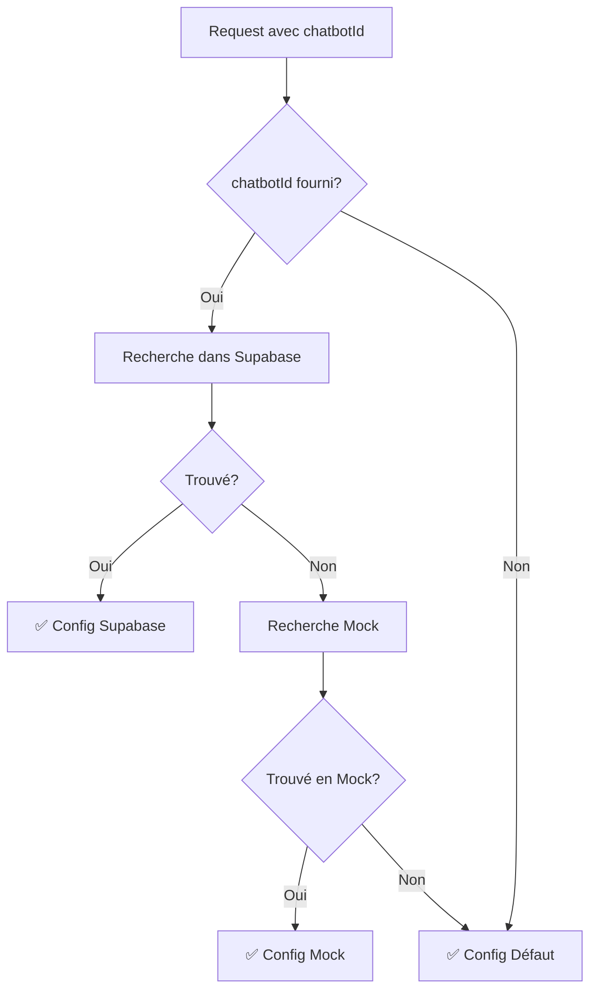

# 🤖 Nouvelle Architecture IA avec Configuration Supabase

## 📋 Vue d'ensemble

Cette architecture met en place un système d'IA modulaire et intelligent avec **récupération automatique des personnalisations depuis Supabase**. Le système est composé d'une IA Master qui orchestre 3 IAs spécialisées, toutes configurées dynamiquement depuis la base de données.

## 🏗️ Architecture

```
┌─────────────────────────────────────────────────────────────┐
│                      CLIENT REQUEST                         │
│                   (avec chatbotId)                          │
└─────────────────────┼───────────────────────────────────────┘
                      │
┌─────────────────────▼───────────────────────────────────────┐
│                   IA MASTER                                 │
│                                                             │
│  1. Récupère config depuis Supabase (ChatbotConfigService) │
│  2. Route vers IA spécialisée appropriée                   │
│  3. Applique personnalisation à la réponse                 │
└─────────────────────┼───────────────────────────────────────┘
                      │
        ┌─────────────┼─────────────┐
        │             │             │
┌───────▼──────┐ ┌───▼────┐ ┌──────▼───────┐
│   IA FAQ     │ │ IA ART │ │ IA OUTFITS   │
│              │ │        │ │              │
│ + Config DB  │ │+ Config│ │ + Config DB  │
└──────────────┘ └────────┘ └──────────────┘
```

## 🆕 Nouveautés - Configuration Supabase

### Service ChatbotConfigService

**Emplacement**: `lib/services/chatbot-config.service.ts`

**Fonctionnalités**:
- ✅ Récupération des configurations depuis la table `chatbots` 
- ✅ Fallback vers configurations mock si Supabase indisponible
- ✅ Validation et normalisation des données
- ✅ Gestion des erreurs robuste
- ✅ Logs détaillés pour le debugging

**Méthodes principales**:
```typescript
// Récupère une config par ID
ChatbotConfigService.getConfigById(chatbotId: string)

// Récupère le chatbot par défaut  
ChatbotConfigService.getDefaultConfig()

// Résolution intelligente (ID > config fournie > défaut)
ChatbotConfigService.resolveConfig(chatbotId?, providedConfig?)
```

### Structure Supabase

**Table**: `chatbots`
```sql
{
  id: string                 -- UUID du chatbot
  name: string              -- Nom affiché
  personality: {            -- Configuration personnalité
    tone: "Amical" | "Professionnel" | "Décontracté" | "Expert" | "Humoristique"
    formality: "Tutoiement" | "Vouvoiement"  
    verbosity: "Concis" | "Détaillé" | "Très détaillé"
    empathy: "Faible" | "Moyenne" | "Élevée"
    proactivity: "Réactif" | "Proactif" | "Très proactif"
  }
  visual_config: {          -- Configuration visuelle
    primaryColor: string
    welcomeMessage: string  
    placeholder: string
    // ... autres paramètres visuels
  }
  is_default: boolean       -- Chatbot par défaut
  status: "Actif" | "Inactif" | "En test"
}
```

## 🔧 APIs Mises à Jour

### 1. IA Master (`/api/ai/master`)

**Changements**:
```javascript
// AVANT
const { message, chatbotConfig = {} } = req.body

// MAINTENANT  
const { message, chatbotId, chatbotConfig = {} } = req.body

// Récupération automatique depuis Supabase
const configResult = await ChatbotConfigService.resolveConfig(chatbotId, chatbotConfig)
const { config, source } = configResult
```

**Priorisation**:
1. **chatbotId** → Récupération depuis Supabase
2. **chatbotConfig** fourni → Utilisation directe
3. **Configuration par défaut** → Fallback

### 2. IAs Spécialisées

Toutes les IAs spécialisées utilisent maintenant le même système:

```javascript
// pages/api/ai/faq.ts
// pages/api/ai/articles.ts  
// pages/api/ai/outfits.ts

const configResult = await ChatbotConfigService.resolveConfig(chatbotId, chatbotConfig)
const personality = config?.personality || defaultPersonality

// Personnalisation OpenAI
const systemPrompt = OpenAIService.createSystemPrompt('faq', personality)
```

### 3. APIs de Compatibilité

**chat.ts** et **chat-stream.ts** modifiées pour accepter `chatbotId`:

```javascript
// Accepte maintenant chatbotId
const { message, context, chatbotId, chatbotConfig } = req.body

// Transmission vers IA Master
body: JSON.stringify({
  message,
  context, 
  chatbotId,        // ← NOUVEAU
  chatbotConfig
})
```

## 📊 Sources de Configuration

| Source | Priorité | Description | Fallback |
|--------|----------|-------------|----------|
| **Supabase** | 1 | Base de données production | Mock configs |
| **Mock** | 2 | Données de fallback | Config par défaut |
| **Default** | 3 | Configuration minimale | N/A |

## 🔄 Flux de Récupération



## 🧪 Tests et Validation

### Script de Test
**Emplacement**: `scripts/test-supabase-chatbot-config.js`

**Tests couverts**:
```bash
npm run dev  # Lancer le serveur
node scripts/test-supabase-chatbot-config.js
```

1. ✅ Connexion Supabase
2. ✅ Récupération chatbots  
3. ✅ APIs avec configuration
4. ✅ Service ChatbotConfigService

### Logs de Debug

Chaque récupération de config génère des logs:
```
🤖 Config chatbot "Assistant Younzee" (ID: abc-123) depuis supabase
🤖 Config par défaut "Assistant Younzee" depuis default
```

## 🔧 Configuration Requise

### Variables d'Environnement
```env
# Supabase (existantes)
NEXT_PUBLIC_SUPABASE_URL=your_supabase_url
NEXT_PUBLIC_SUPABASE_ANON_KEY=your_supabase_key

# OpenAI (existantes) 
OPENAI_API_KEY=your_openai_key
```

### Structure Base de Données

La table `chatbots` doit exister avec:
- Colonnes: `id`, `name`, `personality`, `visual_config`, `is_default`, `status`
- Au moins un chatbot avec `is_default = true`
- Status `'Actif'` pour les chatbots utilisables

## 📈 Avantages

### Flexibilité
- **Configuration centralisée** dans Supabase
- **Personnalisation par chatbot** sans redéploiement
- **Fallbacks robustes** si base indisponible

### Compatibilité  
- **APIs existantes** fonctionnent toujours
- **Migration progressive** possible
- **Interface utilisateur** inchangée

### Monitoring
- **Logs détaillés** de la source de config
- **Métadonnées enrichies** dans les réponses
- **Tracking** de l'utilisation par chatbot

## 🚀 Utilisation

### Client Simple
```javascript
// Utilise le chatbot par défaut
fetch('/api/chat', {
  method: 'POST',
  body: JSON.stringify({
    message: 'Bonjour'
  })
})
```

### Client avec Chatbot Spécifique
```javascript
// Utilise un chatbot spécifique  
fetch('/api/chat', {
  method: 'POST',
  body: JSON.stringify({
    message: 'Bonjour',
    chatbotId: 'professional-support'  // ← Configuration automatique
  })
})
```

### Client avec Override Manuel
```javascript
// Override ponctuel de la config
fetch('/api/chat', {
  method: 'POST', 
  body: JSON.stringify({
    message: 'Bonjour',
    chatbotId: 'my-chatbot',
    chatbotConfig: {         // ← Priorité sur chatbotId
      personality: {
        tone: 'Professionnel',
        formality: 'Vouvoiement'
      }
    }
  })
})
```

## 🐛 Dépannage

### Problèmes Courants

**Config non trouvée**:
```
⚠️ Chatbot abc-123 non trouvé dans Supabase
🤖 Config par défaut "Assistant Younzee" depuis default
```
→ Vérifier l'ID chatbot et le status dans la base

**Supabase indisponible**:
```
❌ Erreur récupération config chatbot abc-123: Network error
🤖 Config "Assistant Mock" depuis mock
```
→ Vérifier les variables d'environnement et la connexion

**Pas de chatbot par défaut**:
```
⚠️ Pas de chatbot par défaut: No rows returned
🤖 Config par défaut "Assistant Younzee" depuis default  
```
→ Définir `is_default = true` sur un chatbot

### Debug

Activer les logs détaillés:
```javascript
// Dans ChatbotConfigService
ChatbotConfigService.logConfigSource(chatbotId, source, configName)
```

---

## 🎯 Migration depuis l'Ancienne Architecture

### Étapes
1. ✅ **APIs mises à jour** - Acceptent `chatbotId`
2. ✅ **Service créé** - `ChatbotConfigService`  
3. ✅ **Fallbacks configurés** - Mock + default configs
4. ✅ **Tests implémentés** - Script validation complet

### Rétrocompatibilité
- Les **anciens appels** fonctionnent (sans `chatbotId`)
- Les **chatbotConfig manuels** sont respectés
- **Aucune rupture** dans l'interface existante

Cette architecture offre une **configuration dynamique avancée** tout en maintenant la **robustesse** et la **compatibilité** du système existant.

## 🎭 IA Master - L'orchestrateur intelligent

### Fonctionnalités clés

1. **🎯 Routage intelligent** : Détermine automatiquement quelle IA spécialisée est la plus appropriée
2. **🎨 Personnalisation complète** : Applique la personnalité du chatbot configurée
3. **🔄 Fallback intelligent** : Gestion des cas non traités par les IAs spécialisées
4. **📊 Monitoring** : Logs détaillés et métriques de performance

### Paramètres de personnalisation

#### 🗣️ Ton de voix
- `"Professionnel"` : Langage formel et précis
- `"Décontracté"` : Langage familier et relaxé  
- `"Amical"` : Chaleureux et bienveillant
- `"Expert"` : Technique et informatif
- `"Humoristique"` : Avec touches d'humour

#### 🎩 Formalité
- `"Tutoiement"` : Utilise "tu", "ton", "ta"
- `"Vouvoiement"` : Utilise "vous", "votre", "vos"

#### 📝 Verbosité
- `"Concis"` : Réponses courtes et directes
- `"Détaillé"` : Réponses équilibrées (défaut)
- `"Très détaillé"` : Réponses longues et exhaustives

#### 💙 Empathie
- `"Faible"` : Réponses factuelles
- `"Moyenne"` : Quelques touches d'empathie
- `"Élevée"` : Très empathique et compréhensif

#### 🚀 Proactivité
- `"Réactif"` : Répond uniquement à la question
- `"Proactif"` : Suggestions supplémentaires occasionnelles
- `"Très proactif"` : Nombreuses suggestions et recommandations

## 🔧 IAs Spécialisées

### 📚 IA FAQ (`/api/ai/faq`)

**Spécialisation** : Questions fréquentes et support client

**Traite** :
- Salutations et politesses
- Questions sur la livraison, retours, paiements
- Informations générales sur le service
- Demandes d'aide

**Exemple** :
```javascript
{
  "message": "Quels sont vos délais de livraison ?",
  "context": {}
}
```

### 👕 IA Articles (`/api/ai/articles`)  

**Spécialisation** : Recommandations d'articles individuels

**Traite** :
- Recherche de vêtements spécifiques
- Filtres par prix, couleur, taille, style
- Recommandations personnalisées
- Comparaison de produits

**Exemple** :
```javascript
{
  "message": "Je cherche un t-shirt noir pour moins de 50€",
  "context": {
    "userPreferences": {
      "budget": { "max": 50 },
      "colors": ["noir"],
      "categories": ["Hauts"]
    }
  }
}
```

### 👗 IA Outfits (`/api/ai/outfits`)

**Spécialisation** : Création d'outfits complets

**Traite** :
- Suggestions de tenues complètes
- Coordination d'articles
- Styles par occasion (travail, soirée, casual)
- Harmonie des couleurs et des styles

**Exemple** :
```javascript
{
  "message": "Je veux une tenue élégante pour le travail",
  "context": {
    "occasion": "travail",
    "style": "chic"
  }
}
```

## 🚀 Utilisation

### 1. API Master (Recommandée)

```javascript
const response = await fetch('/api/ai/master', {
  method: 'POST',
  headers: { 'Content-Type': 'application/json' },
  body: JSON.stringify({
    message: "Je cherche une robe pour une soirée",
    context: {
      conversationHistory: [],
      userPreferences: {},
      userId: "user123"
    },
    chatbotConfig: {
      personality: {
        tone: "Amical",
        formality: "Tutoiement", 
        verbosity: "Détaillé",
        empathy: "Élevée",
        proactivity: "Proactif"
      }
    }
  })
})
```

### 2. APIs de compatibilité

Les anciennes APIs (`/api/chat` et `/api/chat-stream`) restent disponibles et utilisent automatiquement la nouvelle architecture.

```javascript
// Fonctionne exactement comme avant
const response = await fetch('/api/chat', {
  method: 'POST',
  headers: { 'Content-Type': 'application/json' },
  body: JSON.stringify({
    message: "Bonjour, je cherche des conseils mode",
    chatbotConfig: {
      personality: {
        tone: "Humoristique",
        formality: "Tutoiement"
      }
    }
  })
})
```

### 3. IAs spécialisées directement

```javascript
// Appel direct à une IA spécialisée (usage avancé)
const response = await fetch('/api/ai/faq', {
  method: 'POST', 
  headers: { 'Content-Type': 'application/json' },
  body: JSON.stringify({
    message: "Comment retourner un article ?"
  })
})
```

## 🔍 Format de réponse

```javascript
{
  "success": true,
  "response": {
    "id": "master-1703123456789",
    "content": "👋 Bonjour ! Je serais ravi de t'aider...",
    "type": "bot",
    "timestamp": "2024-01-01T12:00:00.000Z",
    "metadata": {
      "intent": "greeting",
      "confidence": 0.9,
      "aiType": "master",
      "routedTo": "faq", 
      "personalityApplied": {
        "tone": "Amical",
        "formality": "Tutoiement",
        "verbosity": "Détaillé",
        "empathy": "Élevée", 
        "proactivity": "Proactif"
      },
      "processingTime": 156
    }
  }
}
```

## 🧪 Tests

### Script de test automatisé

```bash
cd /c/Users/j-phi/Downloads/Younz
node scripts/test-new-ai-architecture.js
```

### Tests manuels dans le navigateur

1. Démarrer le serveur : `pnpm dev`
2. Aller sur la page des chatbots
3. Tester différents messages avec diverses personnalités
4. Vérifier les logs dans la console du serveur

## 📊 Monitoring et logs

L'IA Master génère des logs détaillés :

```
🤖 IA Master - Message reçu: "Je veux un jean"
🎭 Personnalité appliquée: {"tone":"Amical","formality":"Tutoiement"...}
🎯 Routage: {"selectedAI":"articles","confidence":0.8,"reason":"..."}
✨ Personnalisation appliquée
```

## 🔧 Configuration avancée

### Variables d'environnement

```env
# URL de base pour les appels internes
NEXTAUTH_URL=http://localhost:3000

# Logs de debug (optionnel)
DEBUG_AI_MASTER=true
```

### Personnalisation par chatbot

Chaque chatbot peut avoir sa propre configuration dans la base de données :

```javascript
const chatbotConfig = {
  personality: {
    tone: "Expert",
    formality: "Vouvoiement", 
    verbosity: "Très détaillé",
    empathy: "Moyenne",
    proactivity: "Très proactif"
  },
  visualConfig: {
    primaryColor: "#3B82F6",
    welcomeMessage: "Bonjour ! Comment puis-je vous accompagner ?"
  }
}
```

## 🚨 Gestion d'erreurs

L'architecture inclut plusieurs niveaux de fallback :

1. **IA spécialisée échoue** → Routage vers IA FAQ
2. **Toutes les IAs échouent** → Message de fallback personnalisé
3. **Erreur système** → Message d'erreur générique

## 📈 Améliorations futures

- [ ] **Cache intelligent** : Mise en cache des réponses fréquentes
- [ ] **Apprentissage automatique** : Amélioration du routage basé sur l'historique
- [ ] **Analytics avancées** : Métriques détaillées de performance
- [ ] **A/B Testing** : Tests de différentes personnalités
- [ ] **Intégration ML** : IA de recommandation plus avancée

## 🆘 Dépannage

### Problèmes courants

1. **IA ne répond pas** : Vérifier que le serveur Next.js est démarré
2. **Routage incorrect** : Augmenter le niveau de logs pour debug
3. **Personnalisation non appliquée** : Vérifier le format de `chatbotConfig`
4. **Erreur de fetch** : Vérifier l'URL de base dans `NEXTAUTH_URL`

### Logs de debug

Activer les logs détaillés :

```javascript
// Dans pages/api/ai/master.ts
console.log(`🤖 IA Master - Message reçu: "${userMessage}"`)
console.log(`🎭 Personnalité appliquée:`, personality)
console.log(`🎯 Routage:`, routingResult)
```

---

**🎉 L'architecture IA de Younzee est maintenant prête à offrir une expérience conversationnelle personnalisée et intelligente !** 